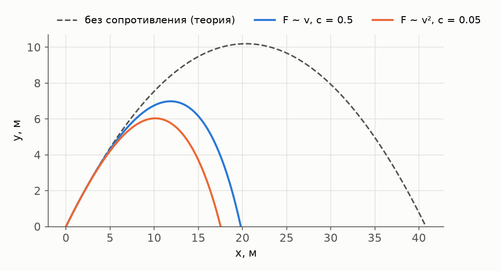
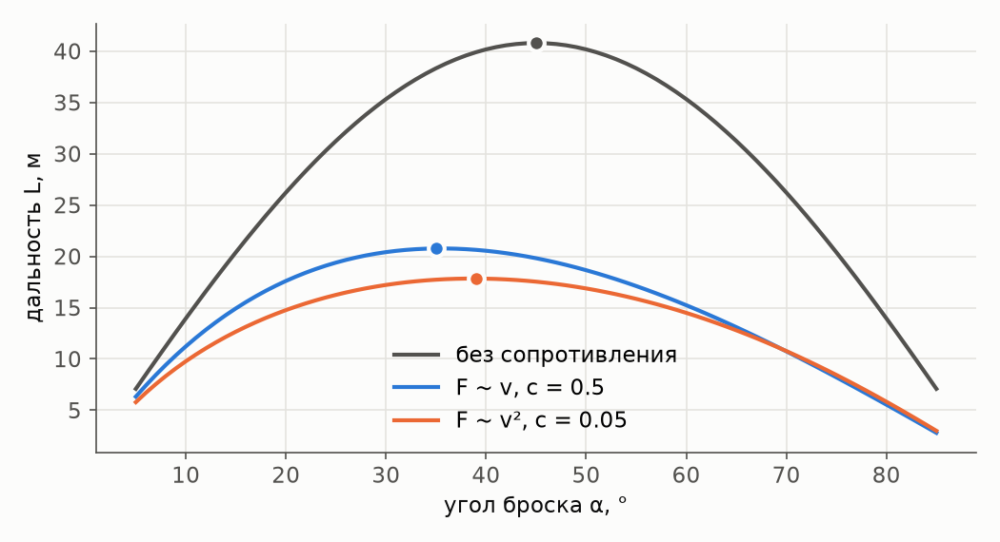
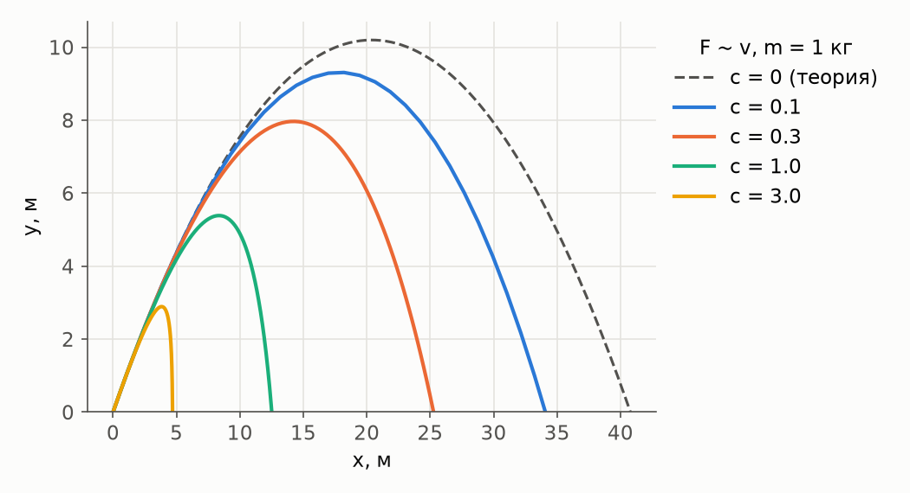

# Отчёт по моделированию полёта камня

## 1. Постановка задачи

Камень бросают под углом α к горизонту с начальной скоростью v₀ в поле тяжести.
Траекторию движения камня рассчитаем численным решением дифференциального уравнения. Исследуем, как траектория зависит от угла, скорости и коэффициента сопротивления, и сравним результаты с аналитическим решением.

## 2. Модель

Второй закон Ньютона:

$$m\frac{d\vec v}{dt} = m\vec g + \vec F$$

Сопротивление воздуха:

- вязкое: $\vec F = -c\,\vec v$
- лобовое: $\vec F = -c\,|\vec v|\,\vec v$

Начальные условия: $\vec r(0) = 0$, $\vec v(0) = v_0(\cos\alpha,\ \sin\alpha)$.

### Теоретические решения для сравнения

Без сопротивления:

$$L = \frac{v_0^2 \sin 2\alpha}{g}, \qquad H = \frac{v_0^2 \sin^2\alpha}{2g}, \qquad \alpha_{\text{опт}} = 45^\circ$$

Вязкое трение, точное решение:

$$x = \frac{m v_{0x}}{c}\left(1 - e^{-\frac{c t}{m}}\right), \qquad y = \frac{m}{c}\left(v_{0y} + \frac{m g}{c}\right)\left(1 - e^{-\frac{c t}{m}}\right) - \frac{m g t}{c}$$

Лобовое сопротивление в общем случае аналитически не решается. Точное решение есть для подъёма при вертикальном броске:

$$H = \frac{m}{2c}\ln\!\left(1 + \frac{c v_0^2}{m g}\right), \qquad t = \sqrt{\frac{m}{c g}}\ \operatorname{arctg}\!\left(v_0\sqrt{\frac{c}{m g}}\right)$$

## 3. Выбор шага интегрирования

Шаг ограничен сверху: $h \le 0.01\,\tau$, где τ — характерное время торможения:

- вязкое: $\tau = m/c$
- лобовое: $\tau = m / \big(c \cdot \max(v_0,\ v_{\text{уст}})\big)$, $v_{\text{уст}} = \sqrt{mg/c}$

Численный опыт для $v_0 = 100$ м/с, α = 89°, m = 1000 кг, c = 16:

| max_step | F ~ v: точек / время / ошибка | F ~ v²: точек / время / ошибка |
|---|---|---|
| 0.001·τ | 315 / 8 мс / 5·10⁻¹² м | 13 865 / 377 мс / 9·10⁻¹¹ м |
| 0.01·τ | 37 / 1 мс / 1·10⁻⁹ м | 1 390 / 38 мс / 9·10⁻¹¹ м |
| 0.1·τ | 10 / 0.3 мс / 1·10⁻⁴ м | 144 / 4 мс / 2·10⁻⁶ м |
| без ограничения | 10 / 0.3 мс / 2·10⁻⁴ м | 33 / 1 мс / 1·10⁻⁴ м |

## 4. Сравнение с аналитическим решением

| Случай | Величина | Численно | Аналитически | Расхождение |
|---|---|---|---|---|
| F ~ v², вертикально: v₀ = 25 м/с, m = 1 кг, c = 0.47 | h, м | 3.651603 | 3.651604 | 2.7·10⁻⁷ м |
| F ~ v², вертикально: v₀ = 25 м/с, m = 1 кг, c = 0.47 | t, с | 0.64725 | 0.64748 | 2.4·10⁻⁴ с |
| F ~ v, c = 1.81·10⁻⁵ против c = 0: v₀ ≈ 18 м/с, α ≈ 56° | L, м | 30.5904 | 30.5915 | 1.1·10⁻³ м |

## 5. Результаты экспериментов

### 5.1. Сравнение моделей сопротивления

v₀ = 20 м/с, α = 45°, m = 1 кг.

С сопротивлением траектория перестаёт быть симметричной: спуск круче подъёма,
потому что к моменту спуска горизонтальная скорость уже погашена.

### 5.2. Оптимальный угол броска

| Модель | α_опт | L_max, м |
|---|---|---|
| без сопротивления | 45° | 40.79 |
| F ~ v, c = 0.5 | 35° | 20.76 |
| F ~ v², c = 0.05 | 39° | 17.83 |

С сопротивлением выгоднее бросать положе: на высокой траектории камень дольше тормозится в воздухе.

### 5.3. Влияние коэффициента сопротивления

### 5.4. Готовые сценарии

| Сценарий | m, кг | c | Дальность, м | Время полёта, с |
|---|---|---|---|---|
| Viscous: basic | 1 | 1.81·10⁻⁵ | 30.59 | 3.06 |
| Viscous: heavy stone | 10 | 1.81·10⁻⁵ | 30.59 | 3.06 |
| Viscous: light stone | 0.1 | 1.81·10⁻⁵ | 30.58 | 3.06 |
| Viscous: high speed | 1 | 1.81·10⁻⁵ | 244.71 | 8.16 |
| Viscous: strong resistance | 1 | 1.81·10⁻⁴ | 30.58 | 3.06 |
| Headon: basic | 1 | 0.47 | 3.25 | 1.35 |
| Headon: heavy stone | 10 | 0.47 | 14.44 | 2.41 |
| Headon: light stone | 0.1 | 0.235 | 0.88 | 0.77 |
| Headon: vertical throw | 1 | 0.47 | 0.00 | 1.77 |
| Headon: strong resistance | 1 | 1.88 | 1.53 | 0.55 |

Ускорение от сопротивления пропорционально c/m, поэтому тяжёлый камень при том же c летит дальше: в лобовой модели при c = 0.47 дальность 14.44 м при 10 кг против 3.25 м при 1 кг.

## 6. Выводы

1. Численное решение дифференциального уравнения движения совпадает с теорией: до 10⁻¹² м для вязкого трения, и до 10⁻⁴ для вертикального броска с лобовым сопротивлением.
2. Шаг 0.01·τ обоснован характерным временем задачи и подтверждён численным опытом.
3. Сопротивление уменьшает дальность и оптимальный угол и делает траекторию несимметричной.
